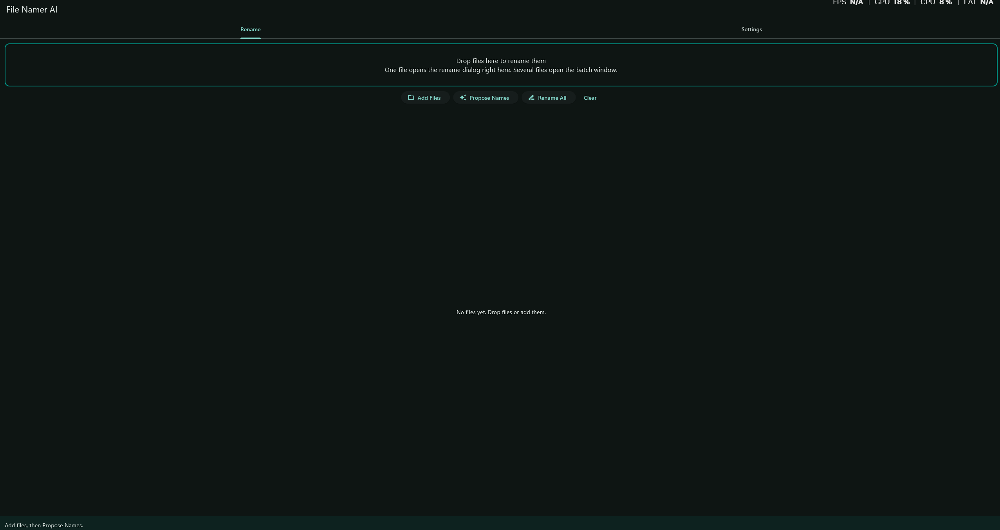
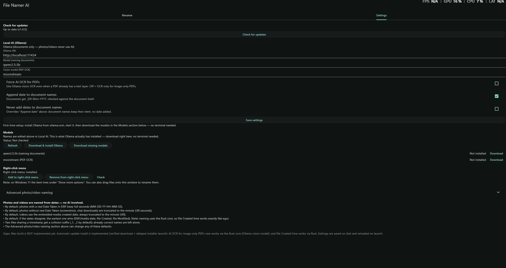

# File Namer AI

  

Right-click any file, or drag files onto the app, to rename them locally:
photos and videos get automatic, customizable date-based names, documents —
including Word, Excel, and PowerPoint files — get smart names from their
contents, in batches too. For Windows — the Mac update is coming next.
No cloud, no uploads.

Built with a Rust core and a [Flutter](https://flutter.dev/) UI, in the
style of RustDesk: all naming, extraction, and Ollama logic lives in
`rust/` (extracted from the egui app) and is called from Flutter via
FFI (`lib/rust_bridge.dart`, hand-written C ABI — no codegen). The
previous all-Rust egui version is preserved on the `egui-legacy`
branch. Distributed as an installer, no console window. Runs as a
normal user (no administrator rights needed).

  
   <em>The Rename tab — drop files in, propose names, rename.</em>

  
   <em>Settings — local AI (Ollama), models, and the right-click menu.</em>

## Download

Grab the latest release from
[Releases](https://github.com/shawnrodis/FileNamerAI/releases):

- **Windows:** `FileNamerAI-Setup-vX.Y.Z.exe` installer — per-user
  install, no admin rights needed. It places the app in
  `%LOCALAPPDATA%\FileNamerAI`, registers the right-click menu, and adds
  an uninstaller.
- **Mac:** not built yet for the Flutter version — the Mac build is still
  pending (the old egui Mac DMG workflow was removed with the migration;
  see Gaps below). The `egui-legacy` branch still has the old Mac build
  instructions.

## How it works

1. Run the app once and click **"Add to right-click menu"** (writes a
   per-user registry entry — no admin needed).
2. For documents: install [Ollama](https://ollama.com), then download the
   naming model in the app's Settings > Models section (or
   `ollama pull qwen2.5:3b`, a ~2GB download, one time). Not needed for
   photos/videos.
3. Right-click any file → "Rename with File Namer AI" (select several files
   to rename them all in one batch window), or drag files onto the app:
   one file opens the rename dialog, several open the batch table.

## Naming rules

- **Photos and videos, deterministic, no AI:** automatic date-based names
  (`MM-DD-YY-HH-MM-SS`). The earliest date wins across the photo's date
  taken, the video's embedded media-created date, and file dates.
  Photos with a real date taken keep full seconds; photos without one
  (screenshots, chat downloads) are truncated to the minute (`:00`
  seconds). Videos are always truncated to the minute.
- **Documents, local AI only:** the app reads the document's text and asks
  local Ollama for a descriptive name — the document's subject, or sender
  + document type, never a field label from the document. Dates are
  written as `DD-Mon-YYYY`, with an underscore only before the date.
  Dates and titles are checked against the document's actual contents
  and are never invented; if a date or title can't be verified, it is
  stripped or the model tries again.
- **Collisions and already-correct names:** two files sharing a timestamp
  get a `_1`, `_2` suffix; files that are already correctly named are
  left alone.

## Settings

Settings mirror the previous version: Ollama connection and models
(Check, Download & Install Ollama, Download missing models, per-model
download with progress), right-click menu, advanced photo/video naming
(date order, separator, time on/off, seconds rule, timestamp source,
collision suffix, prefix/suffix, live preview), Reset to defaults, and
Check for updates at the top. The app follows your Windows light/dark
mode automatically.

## Building (Windows, via GitHub Actions)

This repo is built on `windows-latest` by `.github/workflows/windows.yml`:
Flutter stable → `flutter create --platforms=windows` → copy
`lib/main.dart` and `pubspec.yaml` over the generated project →
`flutter pub get` → `flutter build windows --release` → zip the whole
Release folder (and build the NSIS installer from
`installer/installer.nsi`) → upload artifacts. The exe alone will not
run: it needs `flutter_windows.dll` and `data/`. Extract the whole zip,
or use the setup exe, then run the app inside it.

## Gaps (honest, not hidden)

- AI OCR for image-only PDFs via Ollama vision — not wired up yet
  (the vision model field exists in Settings, but image-only PDFs fall
  back to date-based names for now).
- Mac build — pending for the Flutter version.
- Automatic update installer — Check for updates only reports
  availability for now; download the new release from the releases page.
- File Created time is not available in Dart on all platforms, so the
  earliest-date rule uses the photo/video embedded date + file Modified
  here, where the previous version also used file Created.

## License

GNU General Public License v3.0 — see [LICENSE](LICENSE).
